

<h1 align="center">Commander</h1>

A free, fast, modern two-panel file manager with Total Commander keys. 
Written in Rust. Runs natively on Windows, Linux and macOS.

<a href="https://github.com/tantanu1/public-commander/releases/latest"><b>Download the latest release</b></a>
&nbsp;·&nbsp; <a href="#features">Features</a>
&nbsp;·&nbsp; <a href="#keyboard">Keyboard</a>
&nbsp;·&nbsp; <a href="#plugins">Plugins</a>
&nbsp;·&nbsp; <a href="docs/PLUGIN-DEV.md">Write a plugin</a>

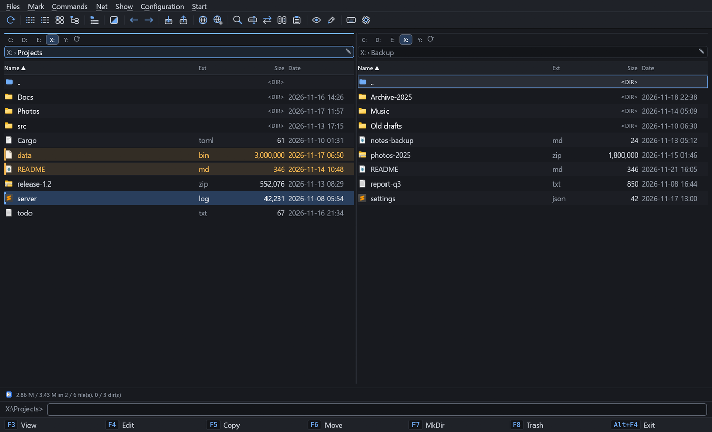

If you have used Total Commander, you already know how to use Commander: same two panels, same
F-keys, same `cm_` command names, same muscle memory. It starts in a blink, never blocks on a slow
drive and opens multi-gigabyte files instantly.

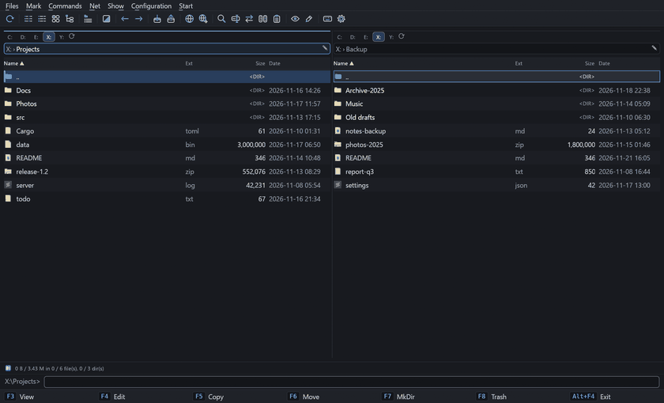

## Download

Get it from the [Releases page](https://github.com/tantanu1/public-commander/releases/latest).
The latest release is **v0.0.11**.

| System | Installer | Plain binary |
|---|---|---|
| Windows x64 / ARM64 | `.msi` | `.exe` |
| Linux x64 | `.deb`, `.rpm`, `.AppImage` | `commander-x86_64-unknown-linux-gnu` |
| macOS Apple Silicon / Intel | `.dmg` | `commander-*-apple-darwin` |

The installers contain **only the app**. The **S3, FTP/FTPS, SFTP and 7-Zip plugins** are a separate
download: **drag `commander-plugins-<version>-<target>.zip` onto a Commander panel** and press
Install. No restart ([how](docs/INSTALL-PLUGINS.md)). The plugin zip must come from the **same
release** as the app (v0.0.11 plugins need Commander v0.0.11 or newer).

macOS: the `.dmg` is ad-hoc signed, not notarized. The first time, right-click `Commander.app` and
choose **Open**.

## Features

### Two panels, the Total Commander way

Full, brief and thumbnail views, folder tabs, drive buttons, breadcrumbs, a command line, a button
bar and the full Total Commander menu. Copy and move run in the background with a queue, an
overwrite dialog, verify and resume. F8 sends to the Recycle Bin / Trash; **Ctrl+Z undoes the last
file operation**.

Commander covers 179 of the 214 Total Commander features we track, and the list keeps growing.

### Lister (F3): text, hex, images and Markdown

Text files of any size open instantly (the file is indexed in the background). Switch between
text, binary, hex, image and **rendered Markdown** with the keys 1 to 5.

| Markdown | Images |
|---|---|
| 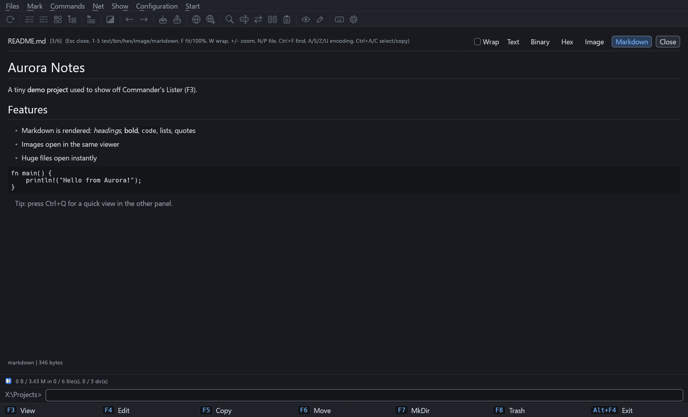 | 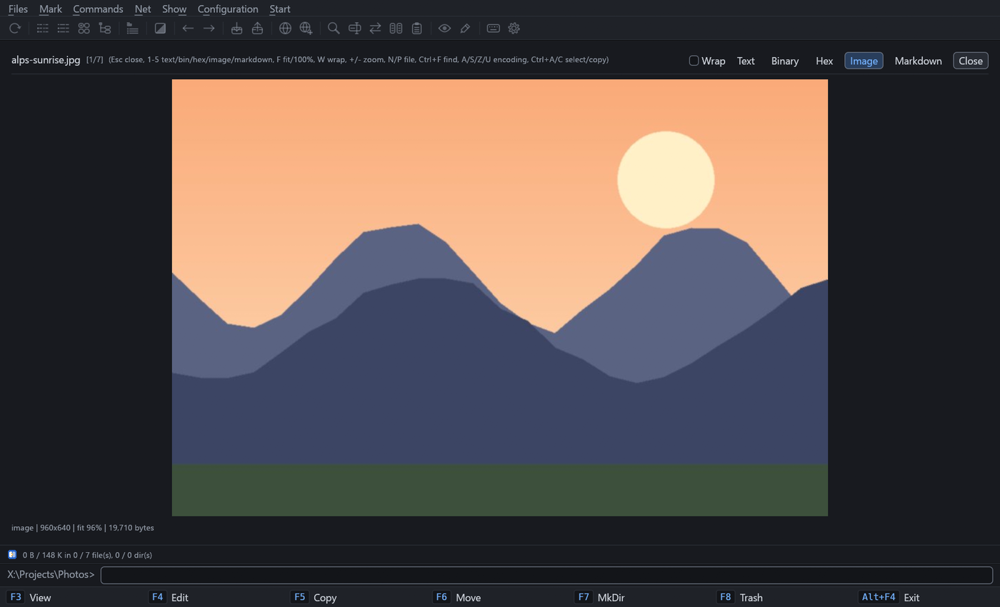 |

### Thumbnails and quick view

Ctrl+Shift+F1 shows thumbnails. Ctrl+Q turns the other panel into a live preview of the file under
the cursor.

| Thumbnails | Quick view (Ctrl+Q) |
|---|---|
| 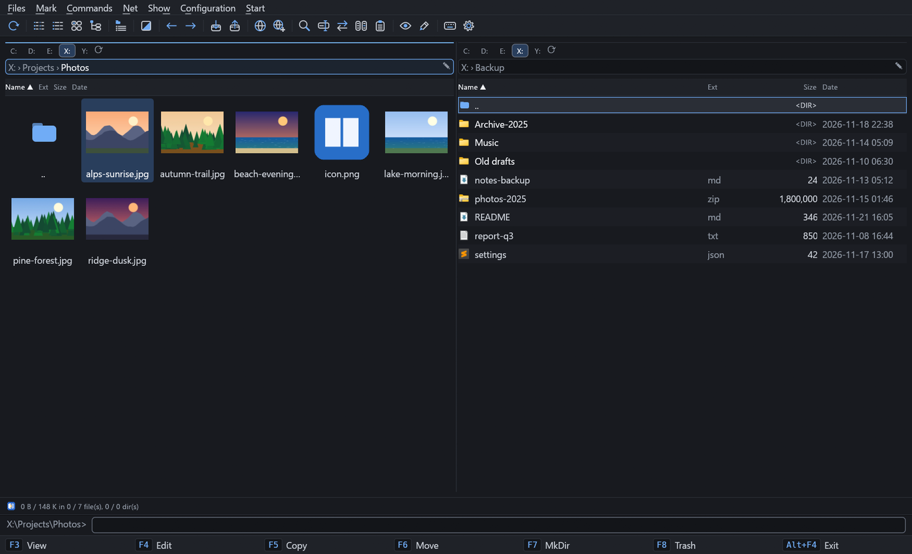 | 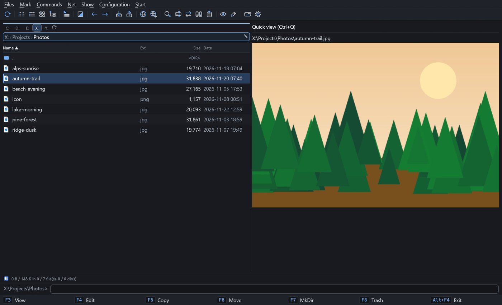 |

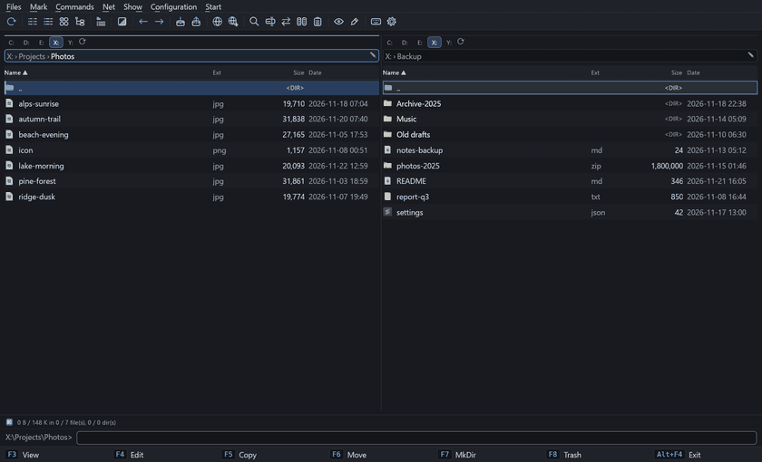

### Find files (Alt+F7)

Search by name (masks or regex), by text inside files (any encoding, or hex), by size, date and
attributes, inside archives, and find duplicate files. Save searches and feed the results to a
panel.

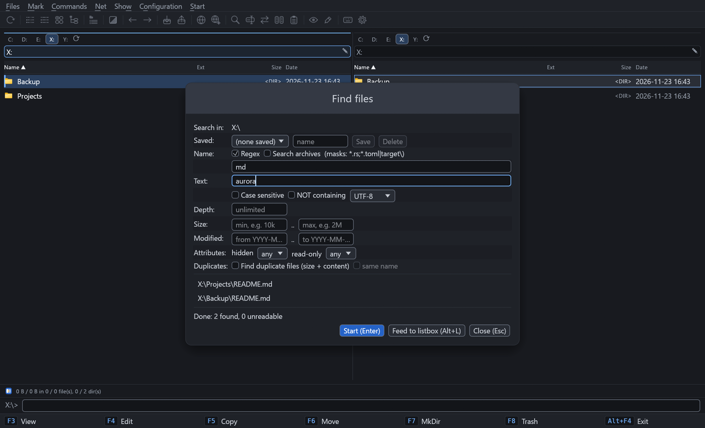

### Archives are just folders

Enter a zip, 7z, tar or tar.gz/bz2/xz with Enter or Ctrl+PgDn and use it like a folder: view, copy
out, copy in, delete. Alt+F5 packs (zip, 7z, tar, tar.gz, tar.bz2, tar.xz), Alt+F9 unpacks; pick the zip name encoding
(CP437, UTF-8, OEM) when a listing looks wrong. With the 7-Zip plugin and 7-Zip
installed, RAR, ISO, CAB, WIM, multi-volume and password-protected archives work too.

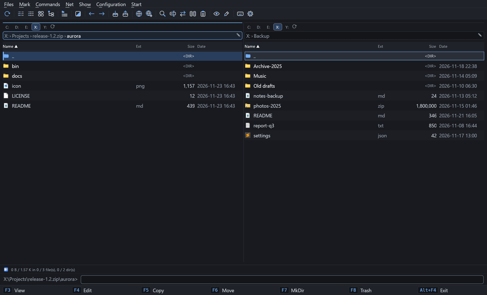

### Columns, comments and trees

Define your own column sets (name, extension, size, dates, attributes, comment, path) in Options
and switch between them. The **comments view** reads and writes `descript.ion`; comments follow
files through copy, move and rename. Open a **separate folder tree** beside either panel
(Ctrl+Shift+F8 cycles), or a **separate quick view window** with Ctrl+Shift+Q that follows the
cursor.

### Quick search

Just start typing: the cursor jumps to the first matching name.

### Recycle Bin and network (Windows)

The Recycle Bin opens as a folder: list, restore and delete. Type `\\server` to list its shares,
map and disconnect network drives from the Net menu (credentials go through the OS prompt), and
paths longer than 260 characters work everywhere.

### Network: FTP, FTPS, SFTP and S3

Ctrl+F opens the connect dialog with your bookmarks. Type `s3://bucket/folder` in the path bar for
Amazon S3 or any S3-compatible storage (MinIO, Cloudflare R2, SeaweedFS). Remote folders work with
the same keys as local ones.

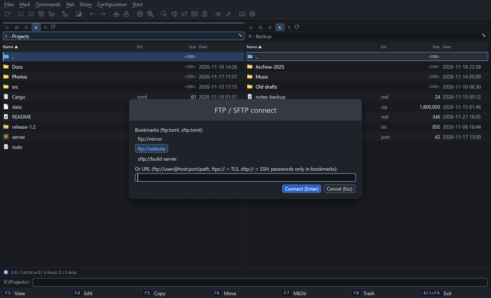

### Clean Disk and open files

**Files > Clean Disk** shows where the space went, WinDirStat-style, and **Files > Processes Using
Selected Files** shows which programs hold a file open (with a safe End process).

| Clean Disk | Processes Using Selected Files |
|---|---|
| 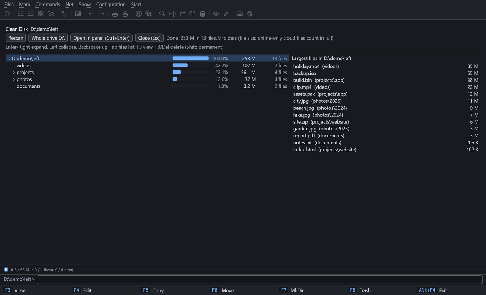 | 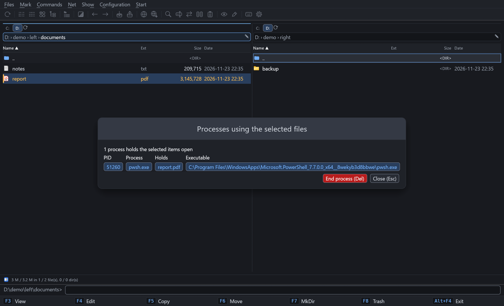 |

### Make it yours

An Options dialog laid out like Total Commander's (including a font page and a packer page), your
own open / view / edit commands per file type, the window position remembered across monitors, dark and light themes, redefinable hotkeys
(Ctrl+Shift+K), a configurable button bar and a Start menu for your own commands.

| Options | Light theme |
|---|---|
| 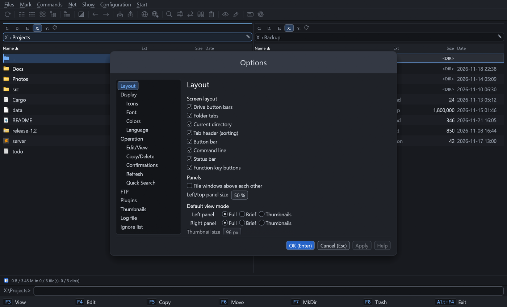 | 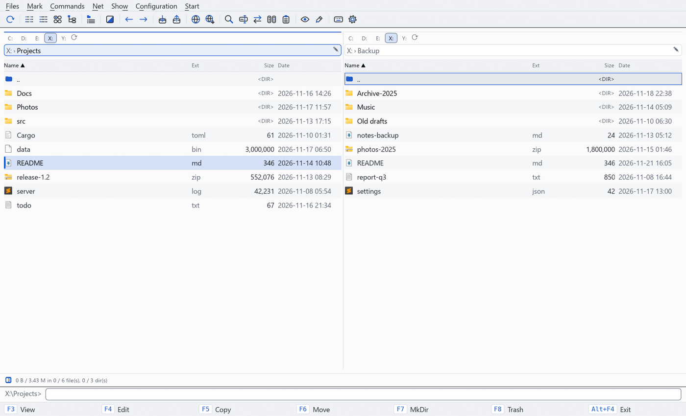 |

### Also included

Synchronize folders (Alt+Shift+S), compare folders (Shift+F2) and files by content, multi-rename
(Ctrl+M), branch view (Ctrl+B), folder sizes, directory hotlist (Ctrl+D) and history, checksums
(CRC32, MD5, SHA1, SHA256, BLAKE3), split and combine files, file attributes, symlinks, hard links
and junctions, drag and drop with Explorer / Finder, copy and paste of files through the OS
clipboard, the shell context menu (Windows) and auto-refresh on changes.

## Beyond Total Commander

- Native on Windows, Linux and macOS (x64 and ARM64 on Windows and macOS, x64 on Linux). Free and
  MIT-licensed.
- S3 and S3-compatible storage (AWS, MinIO, Cloudflare R2, SeaweedFS) as a panel: the `s3` drive
  lists your AWS profiles, then each profile's buckets (or type `s3://bucket/path`). SSO and
  expired credentials show a "Log in" dialog with the exact `aws` command it will run, then Retry.
- A cross-platform plugin API: write plugins in any language with a C ABI, one versioned interface
  for every OS. Manifests are read without loading any plugin code.
- Undo the last file operation (Ctrl+Z).
- Files > Processes Using Selected Files: which programs hold the selection open (PID, name,
  executable, which items), with a confirmed End process. Windows, Linux and macOS.
- Files > Clean Disk (like WinDirStat): folders sorted by size with bars and the largest files,
  filled live while it scans; delete to the Recycle Bin without a rescan.
- Checksums run in a compact window and can go to the background (F2): pause, cancel, and a
  "done" notice that opens the results.
- The row flashes when Enter or a double-click launches a file, so you see it opened.
- Crash log: if Commander ever panics it writes `crash.log` (`%APPDATA%\commander\crash.log`,
  `~/.config/commander/crash.log`); attach it to bug reports.
- F4 on a file in a plugin panel (S3, FTP, SFTP) edits the remote file and sends it back when you
  save; Shift+F4 creates a new one. Plugin copies run in the background queue.
- Panels leave a drive that disappears (USB stick, network share) instead of staying on it.
- Paste a file path into a panel and it opens that folder with the cursor on the file.
- Markdown rendered in Lister (F3).
- Archive-bomb guard when unpacking (size-ratio check and a confirmation; memory-capped decoders).
- Passwords never land in paths, tabs or history: a typed `user:pass@` URL is masked everywhere,
  and FTP/SFTP passwords live only in their bookmark files.
- The duplicate finder skips hard links (one file with two names is not a copy).

## Keyboard

The defaults follow Total Commander. Every key can be changed with Ctrl+Shift+K.

| Key | Action | Key | Action |
|---|---|---|---|
| Tab | Switch panel | F3 | View (Lister) |
| Ins / Space | Select file (Space also sizes a folder) | F4 | Edit |
| Num+ / Num- | Select / unselect group | F5 | Copy |
| letters | Quick search | F6 | Move / rename |
| Enter / Ctrl+PgDn | Open folder or archive | F7 | New folder |
| Backspace | Parent folder | F8 / Del | Delete to Recycle Bin / Trash |
| Ctrl+Z | Undo last operation | Shift+F8 | Delete permanently |
| Ctrl+Q | Quick view | Alt+F7 | Find files |
| Ctrl+F1 / Ctrl+F2 | Brief / full view | Ctrl+Shift+F1 | Thumbnails |
| Ctrl+T / Ctrl+W | New / close tab | Ctrl+D | Directory hotlist |
| Alt+F1 / Alt+F2 | Drive list left / right | Ctrl+U | Swap panels |
| Alt+F5 / Alt+F9 | Pack / unpack | Ctrl+M | Multi-rename |
| Ctrl+F | FTP / SFTP connect | Alt+Shift+S | Synchronize folders |
| Ctrl+S | Quick filter | F9 | Menu |

## Plugins

Plugins add new places to browse. They show up as `scheme://` paths in the panels and work with
the usual keys (F3, F5, F6, F7, F8). They are not in the installers: get
`commander-plugins-<version>-<target>.zip` from the release and **drag it onto a Commander panel**.
It lists the plugins inside, you press Install, and they work at once (no restart). Uninstall in
Options > Plugins. The zip must be from the **same release** as your Commander (v0.0.11 plugins
need v0.0.11 or newer). Unzipping into `%APPDATA%\commander\plugins` (Windows) or
`~/.config/commander/plugins` (Linux/macOS) still works.

| Plugin | How to use | What it does |
|---|---|---|
| S3 | the `s3` drive (Alt+F1 / Alt+F2) or `s3://` in the path bar | Amazon S3 and S3-compatible servers; AWS profiles, SSO login |
| FTP / FTPS | Ctrl+F, bookmarks in `ftp.toml` | FTP and explicit TLS |
| SFTP | Ctrl+F or `sftp://host/path`, bookmarks in `sftp.toml` | SSH file transfer, keys / ssh-agent, strict `known_hosts` checking |
| 7-Zip | just open a `.rar` / `.iso` / encrypted archive | RAR, ISO, CAB, WIM, encrypted and multi-volume archives through your installed 7-Zip |

Check what loaded in **Configuration > Options > Plugins**.

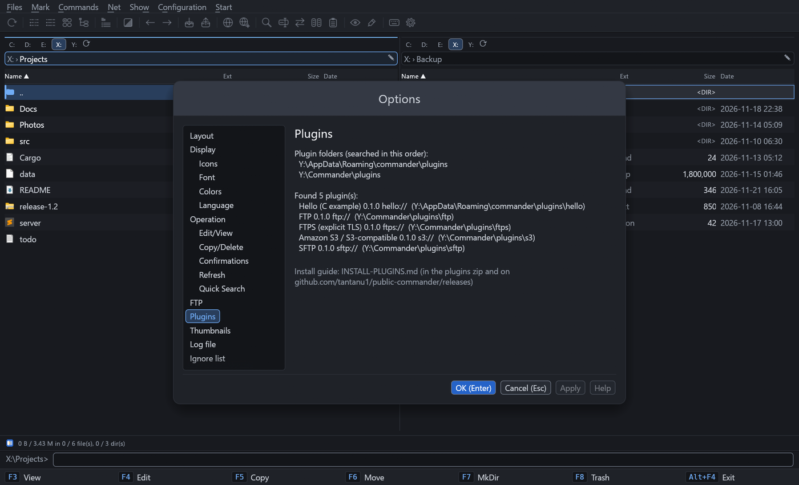

- **Use and configure them:** [docs/INSTALL-PLUGINS.md](docs/INSTALL-PLUGINS.md)
- **Write your own** in C, C++, Rust, Zig, Go or anything that can export a C function:
  [docs/PLUGIN-DEV.md](docs/PLUGIN-DEV.md). The C header is in [sdk/include](sdk/include) and a
  complete example plugin in [sdk/examples/hello-c](sdk/examples/hello-c).

## Documentation

| | |
|---|---|
| [docs/INSTALL-PLUGINS.md](docs/INSTALL-PLUGINS.md) | Installing and setting up plugins (S3, FTP/FTPS, SFTP, 7-Zip) |
| [docs/PLUGIN-DEV.md](docs/PLUGIN-DEV.md) | Plugin developer guide: ABI, manifest, building, testing, packaging |
| [sdk/](sdk) | C header and example plugin |

## How releases are built

This repository is the public home of Commander and its release pipeline; the application source
is built from a private repository. The workflow in `.github/workflows/release.yml` checks out a
tag of the source repo, builds Windows / Linux / macOS binaries, installers and plugin zips, and
publishes them under [Releases](../../releases).

- **Automatic:** every 30 minutes a scheduled run builds the newest `v*` source tag that has no
  release here yet. If there is none, it exits quietly.
- **Manual:** Actions > `release` > Run workflow, enter a tag (e.g. `v0.0.7`). Re-running an
  existing tag re-uploads its assets. `dry_run` builds a branch without publishing.
- No `pull_request` triggers exist, so fork PRs never see the secret. No Actions cache is used, and
  uploaded artifacts expire after 1 day. Build logs are public.
- GitHub disables scheduled workflows after 60 days without commits to this repo; re-enable it in
  the Actions tab or run it manually.

**One-time setup, the `SOURCE_TOKEN` secret** (maintainer only): create a fine-grained token
(GitHub > Settings > Developer settings > Fine-grained tokens) with access to only the source
repository, **Contents: Read-only** and an expiry, then run
`gh secret set SOURCE_TOKEN -R tantanu1/public-commander`. Repository secrets are write-only,
masked in logs and not passed to workflows from forks. When the token expires, runs fail with a
clear error: repeat these steps.

## License

MIT.
